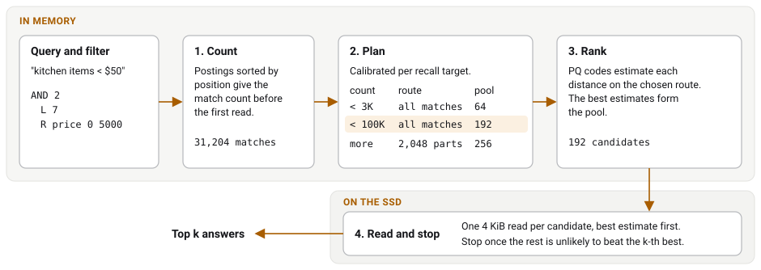
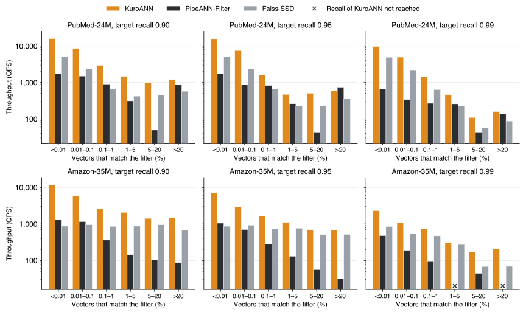

<p align="center">
  
</p>

<h1 align="center">KuroANN</h1>

<p align="center">
  <b>Filtered vector search on SSDs, built to avoid unnecessary SSD reads.</b>
</p>

<p align="center">
  <a href="LICENSE"></a>
  
  
</p>

<p align="center">
  <a href="#how-it-works">How it works</a> · <a href="#results">Results</a> · <a href="#demo">Demo</a> · <a href="#quick-start">Quick start</a> · <a href="#usage">Usage</a> ·
  <a href="#file-formats">File formats</a> · <a href="#reproducing-the-results">Reproducing the results</a> · <a href="#tests">Tests</a> · <a href="#source-tree">Source tree</a>
</p>

---

KuroANN is an approximate nearest neighbor (ANN) search system for embedding vectors with filters, such as "reviews since
2020" or "kitchen items under $50". The raw vectors stay on an SSD, and memory holds a compressed code of each vector.

KuroANN aims to keep each query from reading more from the SSD than its filter needs. Partition-based systems usually give
all queries in a selectivity range the same search budget, sized for the query that needs the most, so many queries read
candidates that do not change their answer. KuroANN instead sets the reads of each query from its match count, the number of
vectors that pass its filter. It knows this count before the first SSD read, because its lists of matching vectors are sorted
by position in the index. A small table, called the plan, turns the count into how widely the query searches and when it
stops reading. Calibration measures each row of the plan on sample queries, against a recall target.

## How it works

<p align="center"></p>

1. **Index.** K-means splits the vectors into partitions. Each vector gets a product quantization (PQ) code in memory, and its raw
   values go to the SSD, so that reading one candidate takes one 4 KiB read.
2. **Postings.** Each label keeps the positions of its vectors in partition order. The length of a posting is the label's count,
   and a binary search finds its members inside any partition without touching the other partitions.
3. **Count.** A filter is an expression over labels and attributes. Its count comes from the lengths of the postings and of the
   attribute ranges. KuroANN computes the exact count, first by sampling, only when these bounds select different plan rows.
4. **Plan.** The row for the count sets the route, the pool, and the stop table. The exhaustive route ranks every match by its code.
   The partition route ranks the matches inside the nearest partitions. When the matches of a label crowd around a query, the
   count of the nearest partitions can pick the row instead.
5. **Stopping.** KuroANN reads the pool from the best estimate down. Calibration measures the error of the estimates at each rank, so
   each unread candidate gets an optimistic bound on its distance. Reading stops once no unread candidate is likely to beat the
   current k-th best.

## Results

`scripts/reproduce.sh` measures KuroANN and two baselines on two datasets with real filters.

- **PubMed** (RAG retrieval): 23,898,701 PubMed abstracts from Qdrant/PubMed-MV, embedded with BGE-M3 (1024 dimensions), with
  publication types, MeSH terms, and the publication year as filters. The queries are bioRxiv titles from the same dataset.
  6,737 queries are measured, and 2,887 more calibrate the plans.
- **Amazon** (recommendation): 35,077,399 items of Amazon Reviews'23, embedded with BLaIR (768 dimensions), with categories,
  ratings, and prices as filters. A query is the mean of a shopper's recent items. 7,000 queries are measured, and 3,000 more
  calibrate the plans.

The baselines are PipeANN-Filter (PipeANN with its filtered search, `baselines/pipeann.patch`) and Faiss-SSD (Faiss's IVF-PQ
over KuroANN's partitions and codes, reranking from the same SSD file, `baselines/faiss_ssd.cpp`). Each query asks for the 10
nearest vectors that pass its filter. The queries are grouped by the fraction of vectors that their filter matches. In each
group, KuroANN uses the plan calibrated for the target, and its recall is the one it reached on the measured queries. Each
baseline gets its fastest setting whose recall is at least that recall, and "not reached" means that none of its settings got
there. The testbed is one CloudLab c6620 machine (Intel Xeon Gold 5512U with 28 cores, 128 GB of memory, Dell DC NVMe 7450 SSD)
with 28 search threads.

<p align="center"></p>

In these runs, KuroANN was faster than both baselines in 35 of the 36 cells, by 1.1 to 8.8 times over the faster of the two.
The exception was PubMed filters that match more than 20% of the vectors at target 0.95, where PipeANN-Filter was 1.23 times
faster. The plans reached their target in 33 of the 36 cells and fell short by at most 0.0073 in the other three.
`assets/results.csv` lists every cell with the recall of KuroANN, and `scripts/plot.py` draws the figure from the measurements.

## Demo

**[Try the recorded demo in your browser](https://gyuyeongkim.github.io/KuroANN-public/).** The page replays lookups
recorded on the PubMed and Amazon data above, for semantic search, recommendation, and RAG, and compares each lookup with
PipeANN-Filter and Faiss-SSD at the same recall. It needs no server.

## Quick start

You need Linux with `liburing`, a C++17 compiler, CMake, OpenMP, and Python 3 with NumPy. The scan uses AVX-512 when the
CPU has it, and plain C++ otherwise.

```sh
sudo apt-get install build-essential cmake liburing-dev python3-numpy
cmake -B build && cmake --build build -j
./build/test_index
examples/quickstart.sh
```

The quick start builds an index over 200,000 synthetic vectors, calibrates a plan for recall 0.99, and searches with filters.
It prints the throughput, the latency, the reads per query, and the recall.

## Usage

### Build an index

The input vectors are a `.fbin` file (`u32` count, `u32` dimension, then `float32` values), or the same layout with `uint8` values.
Labels are an optional sparse matrix, and attributes are optional files in vector order.

```sh
build/kuroann build --base base.fbin --index idx/pubmed --pq 128 \
    --labels labels.spmat --range year=year.u32 --string journal=journal.txt
```

`--pq` is the number of bytes per PQ code, and it must divide the dimension. `--partitions` defaults to the power of two nearest to
one partition per 2,500 vectors. A vector must fit in a 4 KiB block, and the distance is squared L2, so normalize the vectors
first for cosine similarity.

### Write filters

A filter is a prefix expression, one per query line in a filter file.

| Expression | Meaning |
|---|---|
| `ALL` | every vector |
| `L 7` | has label 7 |
| `R year 2020 2024` | 2020 <= year < 2024 |
| `S journal eq Nature` | the string equals the value; string values cannot hold spaces |
| `S journal in Nature,Science` | the string is one of the values |
| `S journal like %Med%` | SQL `LIKE`, with `%` and `_` |
| `AND 2 e1 e2`, `OR 2 e1 e2`, `NOT e` | combinations |

For example, `AND 2 L 7 R year 2020 3000` matches label 7 since 2020.

### Calibrate a plan

```sh
python3 scripts/calibrate.py --index idx/pubmed --queries sample.fbin --filters sample.expr \
    --out plan/pubmed --kuroann build/kuroann --targets 0.9,0.95,0.99
```

The sample queries should resemble the real ones and cover the filter widths you expect. A few thousand were enough for the
datasets above. The script computes their exact answers, measures stop tables, sweeps settings with the engine, and writes
`plan_90.txt`, `plan_95.txt`, and `plan_99.txt`. Run it alone on the machine, because the sweep measures throughput.

### Search

```sh
build/kuroann search --index idx/pubmed --queries test.fbin --filters test.expr \
    --plan plan/pubmed/plan_99.txt --threads 32 --rounds 3 --out results.bin --query-stats stats.tsv
```

`--local-partitions N` also counts a label filter, or an OR of labels, in the N partitions nearest to each query. When the
matches there are more than `--local-ratio` (default 2) times as dense as in the whole index, that count picks the plan row.
With `--groundtruth`, the tool also reports recall. `scripts/groundtruth.py` computes the exact filtered answers. A distance tie
counts as a hit, because tied vectors are interchangeable. `--settings partitions:pool,...` with `--route` runs fixed settings
instead of a plan.

### Update

Updates serve label filters, so they need an index built without attributes:

```sh
build/kuroann build --base base.fbin --index idx/labels --pq 128 --labels labels.spmat
build/kuroann update --index idx/labels --insert new.fbin --insert-labels new.spmat --remove gone.u32
```

New vectors take the next ids and go to a delta segment of their partition, and removals set a tombstone. Both take effect at
once and change the counts that the plan reads, so random inserts and removals usually do not need a new plan. A merge moves
the delta segment into the packed arrays, in the order of a fresh build, and drops the removed vectors. The command above also
merges and saves. Updates must not overlap searches on the same index.

### From C++

```cpp
#include "kuroann/index.h"

kuroann::Index index("idx/pubmed");
index.load_plan("plan/pubmed/plan_99.txt");
kuroann::Predicate filter(index, "AND 2 L 7 R year 2020 3000");

kuroann::Searcher searcher(index, 10, index.plan_max_pool());   // one per thread
kuroann::Hit hits[10];
kuroann::SearchStats stats;
uint32_t n = searcher.search(query, filter, hits, &stats);

kuroann::Index labeled("idx/labels");                            // updates need an index without attributes
std::vector<uint32_t> ids = labeled.insert(vectors, count, labels);
labeled.remove(ids[0]);
labeled.merge();
labeled.save();
```

### Python

```sh
pip install .
```

```python
import kuroann

kuroann.build("base.fbin", "idx/pubmed", labels="labels.spmat", ranges={"year": "year.u32"}, pq=128)
index = kuroann.Index("idx/pubmed")
index.load_plan("plan/pubmed/plan_99.txt")
filters = ["AND 2 L 7 R year 2020 3000"] * len(queries)
ids, distances, reads = index.search(queries, filters, k=10)    # queries: (n, dim) float32
```

`search` releases the GIL and follows the plan. `insert`, `remove`, `merge`, and `save` work as in C++.

## File formats

| File | Contents |
|---|---|
| `P.meta` | `int32`: vectors, dimension, partitions, PQ pieces, piece length, codes per piece, bytes per element, next id |
| `P.coarse`, `P.book` | centroids and PQ codebooks, `float32` |
| `P.codes` | PQ codes in partition order |
| `P.lptr`, `P.lids` | first position of each partition, vector id at each position |
| `P.siptr`, `P.sidx` | first entry of each label, ascending positions per label |
| `P.vectors` | raw vectors by id, whole vectors per 4 KiB block |
| `P.attr.*` | attribute values per position, with sorted values or a dictionary for the count |

A label matrix is `i64` rows, columns, entries, then `i64` row starts, `i32` labels, and `f32` values. A ground-truth file is `u32` queries,
`u32` k, `u32` ids, and `f32` distances. `kuroann search --out` writes the same layout, and a query with fewer than k results
ends its list with id 4294967295 and distance infinity. A plan row reads
`vmax=<count> np=<partitions, 0 for exhaustive> L=<pool> alpha=<a> [table=<path>]`. The ids of `--remove` are `u32`.

## Reproducing the results

```sh
sudo apt-get install build-essential cmake liburing-dev libboost-all-dev libeigen3-dev libjemalloc-dev \
  libgoogle-perftools-dev libaio-dev libmkl-dev intel-mkl
python3 -m venv venv
venv/bin/pip install numpy pyarrow huggingface_hub lxml torch transformers matplotlib
PYTHON=venv/bin/python scripts/reproduce.sh
```

The script downloads the data, embeds the Amazon items, builds the indexes, computes the exact answers, calibrates the plans,
and measures. It writes `results/summary.csv` and `results/throughput_by_band.svg`, the table and the figure of the results above. A finished step is kept, so a run that
stopped continues from where it stopped. `DATASETS`, `SYSTEMS`, and `THREADS` choose a part of the work. `LIMIT=200000` builds
and measures a sample of about 200,000 vectors per dataset, but the NLM records and the Amazon metadata are still downloaded in
full. The downloads are pinned to the versions measured here, except the NLM baseline, which NLM replaces every December.
`NLM_BASELINE` selects a later year, whose filters and results differ. From nothing, Amazon with KuroANN and Faiss-SSD took
19 hours 20 minutes on the machine above and peaked at 110 GB of memory. The finished Amazon directory takes 350 GB of disk,
97 GB of which are the downloaded source files.

## Tests

`build/test_index` builds indexes over synthetic data and compares them with a brute-force oracle. Over 17 filters, the exhaustive route
and the partition route over all partitions must return the exact answer. It also checks the pool limit, stopping, plan rows, the local count,
rejected expressions, and blocks with two vectors. The same oracle checks both routes with a delta segment, with tombstones, after a merge, and
after a reload. Inserting held-out vectors and merging must give the files of a fresh build, byte for byte. `tests/test_python.py` runs
the same kind of checks through the Python module.

## Source tree

```
include/kuroann/index.h    API: build, load, predicates, search
src/build.cpp              k-means, PQ training, partition order, postings, attributes, block file
src/graph.cpp              graph over the partition centroids
src/index.cpp              index and plan loading
src/predicate.cpp          filter expressions: bounds on the count, evaluation in position order
src/search.cpp             plan row, scan, reads, stopping
src/update.cpp             delta segment, tombstones, merge, save
tools/kuroann.cpp          command-line tool: build, search, update
python/                    Python module
scripts/                   calibration, exact ground truth, datasets, the summary and figure, and the reproduction script
baselines/                 PipeANN-Filter patch, Faiss-SSD, and the benchmark driver
tests/                     checks against a brute-force oracle
examples/                  synthetic data and quick start
assets/                    logo and figures
```

## License and contact

Copyright 2026 Gyuyeong Kim (Yonsei University). Licensed under the Apache License, Version 2.0 (see `LICENSE` and `NOTICE`).

Questions and bug reports: Soobin Cho (tnqls40168@gmail.com) and Gyuyeong Kim, Yonsei University (gyuyeong.kim@yonsei.ac.kr)
